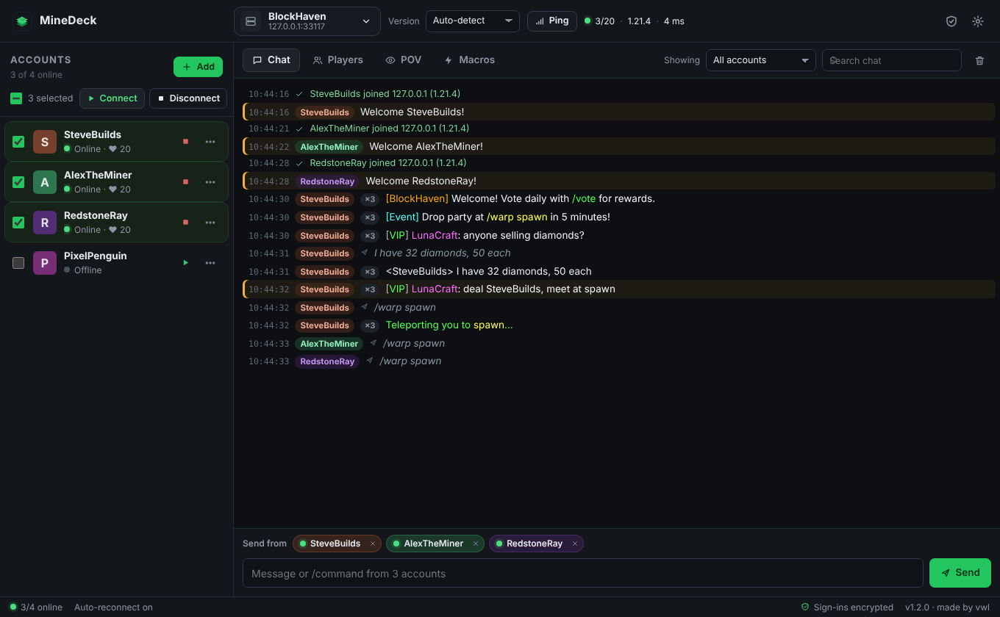
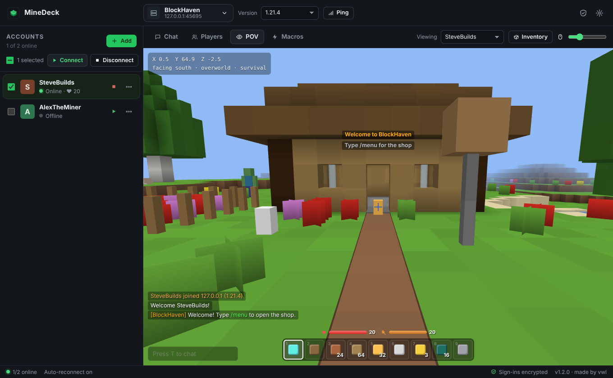
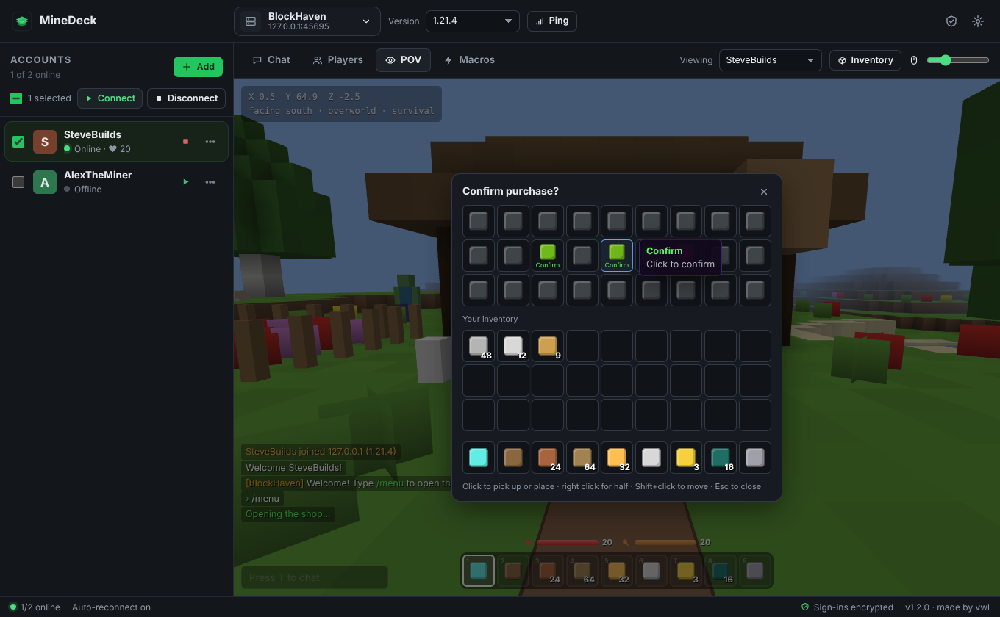
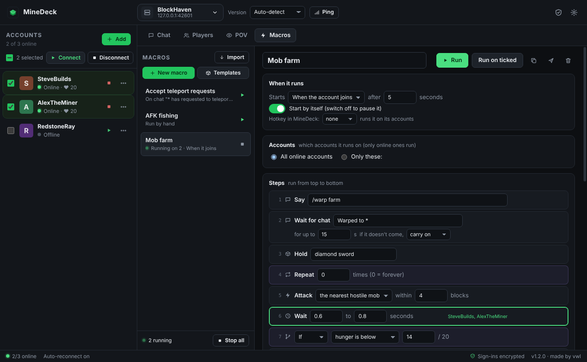
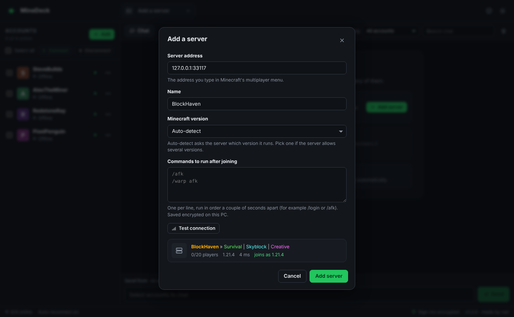
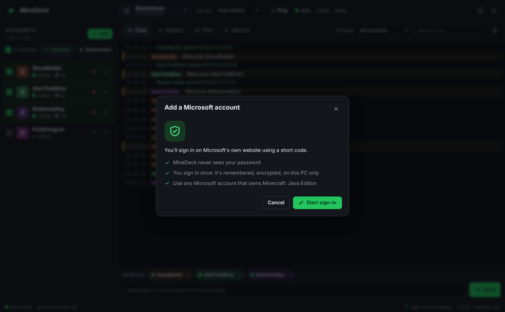
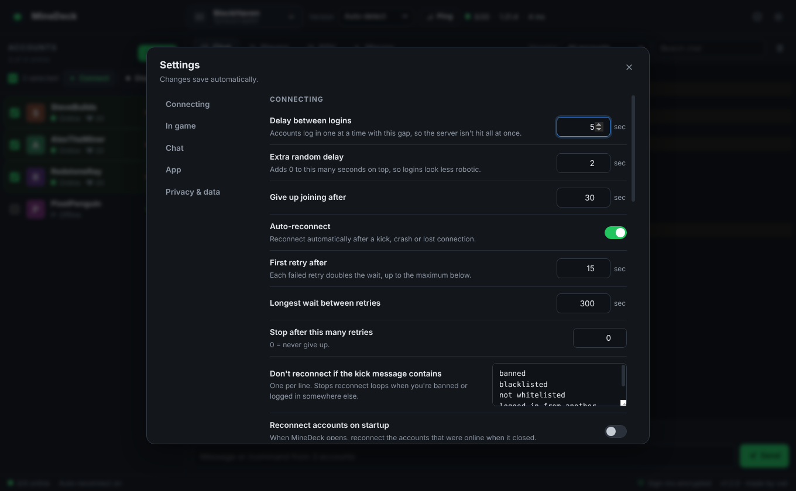
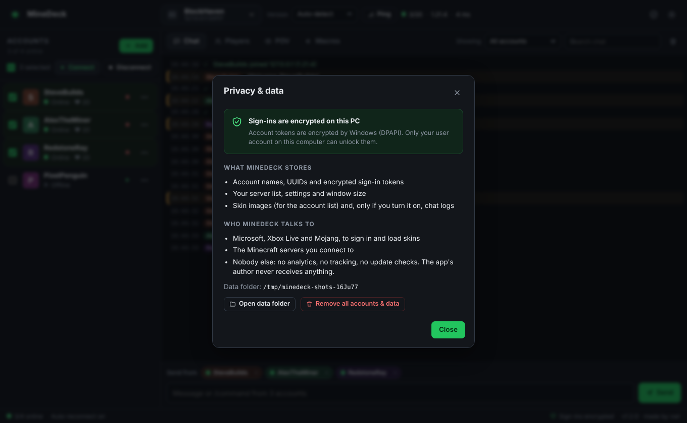

# MineDeck

*Made by vwl.* · Official downloads: **[vwlmc/MineDeck-Console-Client releases](https://github.com/vwlmc/MineDeck-Console-Client/releases)**

**An open-source desktop client for running several Minecraft: Java Edition accounts at once.**
Sign in with your Microsoft accounts, pick a server and a version, and watch and use chat from all of your accounts in one window. No game launcher needed: when you want to look around as one of the accounts, walk somewhere or click "Confirm" in a server menu, the **POV** tab lets you see and control it right inside MineDeck, and **Macros** let your accounts do things by themselves.



- **Your accounts stay on your PC.** You sign in on Microsoft's own website, and MineDeck stores the resulting sign-in encrypted by Windows. Nothing is ever sent to the people who made or host MineDeck. There is no MineDeck server, no telemetry and no update check. [How this works](#privacy-and-security), and the details in [SECURITY.md](SECURITY.md).
- **Fully open source** (MIT License), with an automated, verifiable build. You can read every line, or build it yourself.

## Features

**Accounts**
- Add as many Microsoft accounts as you like. Sign-in uses Microsoft's device code page, so MineDeck never sees a password.
- **Sign in once.** Sign-ins are saved encrypted with Windows DPAPI (macOS Keychain or the Linux keyring on those systems) and renewed automatically, so accounts stay signed in when you close MineDeck or restart the PC.
- Skin faces in the account list, with each account's status, ping and health, and its food, position and dimension when you hover over it.
- Reorder accounts, copy UUIDs, remove an account, or remove everything at once.

**Servers and versions**
- Save any number of servers by address (`play.example.com`, `1.2.3.4:25566`, SRV records work).
- **Every release from 1.7.10 to 26.1.2**, or *Auto-detect*, which asks the server which version it runs.
- Ping and server preview (MOTD, players, version, favicon) before joining.
- Commands to run after joining, per server (for example `/login`, `/afk` or `/warp afk`).

**Chat**
- One chat window for all accounts, with Minecraft colours and formatting.
- When several accounts see the same message it is shown once, with a `×3` badge.
- Show chat from **all accounts**, only the **selected accounts**, or **one account**.
- Send messages and `/commands` from any set of accounts: tick the accounts on the left, and the chips above the message box show who will send. Messages from several accounts are spaced out so they don't trigger spam kicks.
- **Clickable chat:** servers' chat buttons like `[ACCEPT]`, `[Click to confirm]` or `[Vote]` work: clicking runs the command from the account that got the message (if several accounts got it, you pick which). Hovering shows the server's hover text; links are copied rather than opened.
- Search, timestamps, highlight words (your account names are highlighted automatically), and a taskbar flash when you're mentioned.
- Message history with the up and down arrow keys. Press `/` anywhere to start a command, and `Ctrl+F` to search.
- A Players tab with each server's tab list and pings.
- Optional chat logs saved as text files on your PC (off by default).

**POV: see and control an account**
- The **POV** tab (or *Open POV* in an account's ⋯ menu) shows the world around one account in 3D, and lets you take over: **look around** with the mouse, **walk** with W A S D, jump, sneak and sprint, hit mobs and break blocks, use and place items, and pick hotbar slots with 1-9 or the mouse wheel.
- **Server menus** ("click to confirm" screens, shops, server selectors and other chest-style menus) open in the POV with every item's name and description. Click, right-click and Shift+click work like in the game. When a server opens a menu for any of your accounts, MineDeck says so in the chat window and offers to open it in the POV.
- **Chat and commands** from inside the POV (`T` to talk, `/` for a command), sent from the account you're viewing, with that account's chat shown like in the game.
- Your inventory (`E`), health, hunger and level, titles and action bar messages, name tags of players and holograms, and a respawn button when auto-respawn is off.
- Blocks, items and mobs are drawn as coloured shapes rather than with Minecraft's textures, which belong to Mojang and aren't included. The 3D view needs WebGL 2 (any graphics driver from the last several years has it); without it the POV still shows menus, the hotbar and chat, and movement still works.





**Macros: let accounts do things by themselves**
- A **Macros** tab with a step-by-step editor: pick steps from a menu and fill in the blanks, no programming. Steps can **say** messages and run **commands**; **wait** (a set or random time, for a chat message, or for a menu); **click** items in menus by name; **right-click**; **attack** (what's in front, or the nearest hostile mob, mob, player or named entity); **fish**; **eat**; **hold**, **drop** and pick hotbar slots; **look**, **walk**, **walk to** coordinates, jump, sneak, sprint and respawn.
- **Logic:** Repeat (a number of times or forever), If / Otherwise (health, hunger, items in the inventory, an open menu, recent chat, a random chance, or comparing text), variables, notes and pop-ups, running another macro, stop, and disconnect.
- **Starts by itself** if you want: when an account joins, when chat says something (with `*` wildcards whose text the steps can use, like `/tpaccept {1}`), every few minutes, when a menu opens, when the account dies, or when its health gets low. Or run it with its **F-key**, the ▶ button, or from an account's ⋯ menu.
- Runs on all online accounts or the ones you choose, spaced out so they don't all act at once. It can loop, and start again by itself after a reconnect. You see which step each account is on, and can stop any of them.
- **Templates** to start from: hub menus, AFK fishing, mob farms, eating, daily rewards, `/sell all`, accepting teleports, away replies, confirming menus, join alerts, leaving on low health, and walking back and forth.
- **Share** a macro as text and **Import** other people's. Macros are data, not code: they can only do the steps in the editor, so an imported macro can't read your files or sign-ins. Imported macros start with their automatic start switched off.
- Built-in limits so accounts don't flood a server: a macro's messages and commands are at least 0.3 seconds apart per account, loops can't run faster than 20 times a second, and a macro that keeps starting itself from chat (more than 20 times a minute) is switched off.
- Saved encrypted on your PC, like sign-ins (a macro may contain a `/login` password).



**Staying connected**
- **Login delay**: accounts join one at a time with a configurable gap (and an optional random extra delay), so the server isn't hit by every login at once.
- **Auto-reconnect** after kicks, crashes, restarts or lost internet, with a growing wait between tries, an optional retry limit, and a stop list of kick messages that should *not* trigger a reconnect (for example *banned* or *logged in from another location*).
- Optional anti-AFK actions, auto-respawn, accepting server resource packs, and "reconnect the accounts that were online last time" on startup.
- **Survives restarts:** optionally start MineDeck when you sign in to Windows and reconnect the accounts that were online, so after a PC restart (even a Windows Update one) your accounts come back by themselves.
- Minimize to the system tray, and keep the PC from sleeping while accounts are online.

## Download and run (Windows)

1. Download `MineDeck-<version>-setup.exe` (installer) or `MineDeck-<version>-portable.exe` from the **[Releases page](https://github.com/vwlmc/MineDeck-Console-Client/releases)**. Only download MineDeck from there: copies from anywhere else may have been changed. The first releases are also available as a zip (`MineDeck-<version>-win-x64.zip`): extract it anywhere and run `MineDeck.exe`.
2. Check the download (optional, but recommended): compare its SHA-256 with `SHA256SUMS.txt` from the release:
   ```powershell
   Get-FileHash .\MineDeck-1.2.3-win-x64.zip -Algorithm SHA256
   ```
3. The builds are not code-signed (a certificate costs money every year), so the first time Windows may show *"Windows protected your PC"*. Click **More info**, then **Run anyway**.

MineDeck keeps its data in `%APPDATA%\MineDeck`. To uninstall, use **Privacy & data → Remove all accounts & data** in MineDeck first, then uninstall (or delete the folder) and delete `%APPDATA%\MineDeck`.

## Getting started

1. **Add a server.** Click *Add a server*, enter the address and leave the version on *Auto-detect* (or pick one). *Test connection* shows whether the server is reachable.

   

2. **Add your accounts.** Click *Add*, then *Start sign-in*. MineDeck shows a short code: open `microsoft.com/link` (the button does this), enter the code, and sign in with the Microsoft account that owns Minecraft. MineDeck picks up the sign-in by itself. Repeat for each account. You only do this once per account: MineDeck remembers the sign-in (encrypted) and renews it in the background. You'd only sign in again after changing that account's Microsoft password, signing it out everywhere, or leaving MineDeck unused for a long time.

   

3. **Connect.** Tick the accounts and press **Connect**. They join one after another using the login delay from Settings. The ■ / ▶ button on each account connects or disconnects just that one.
4. **Chat.** Type in the box at the bottom and press Enter. The message is sent from every ticked account that is online (shown as chips above the box). Use the *Showing* menu to choose whose chat you see.
5. **See and control one account (optional).** Open the **POV** tab and pick an online account under *Viewing*. Click the view to take the mouse (press `Esc` to get it back). `E` opens the inventory and `T` the chat. Server menus appear on top of the view: click the items you want, then close the menu with `Esc` or the × button.
6. **Automate (optional).** Open **Macros** and press **Templates** to add a ready-made one, or **New macro** to build your own with **Add step**. Choose when it runs and on which accounts, then press **Run**, or switch on *Start by itself*.

**Hands-free after a restart:** in Settings, turn on *Reconnect accounts on startup* (Connecting) and *Start MineDeck when you sign in to Windows* (App). After the PC restarts, MineDeck starts in the background and brings back the accounts that were online.

To move online accounts to a different server or version, select the new server or version and press the button in the notice that appears (*Move to …* or *Reconnect them*).

### Supported versions

| Series | Versions |
| --- | --- |
| 26.1 | 26.1, 26.1.1, 26.1.2 |
| 1.21 | 1.21 – 1.21.11 |
| 1.20 | 1.20 – 1.20.6 |
| 1.19 | 1.19 – 1.19.4 |
| 1.18 | 1.18 – 1.18.2 |
| 1.17 | 1.17, 1.17.1 |
| 1.16 | 1.16 – 1.16.5 |
| 1.15 | 1.15 – 1.15.2 |
| 1.14 | 1.14, 1.14.1, 1.14.3, 1.14.4 |
| 1.13 | 1.13 – 1.13.2 |
| 1.12 | 1.12 – 1.12.2 |
| 1.11 | 1.11 – 1.11.2 |
| 1.10 | 1.10 – 1.10.2 |
| 1.9 | 1.9, 1.9.2, 1.9.3, 1.9.4 |
| 1.8 | 1.8 – 1.8.9 |
| 1.7 | 1.7.10 |

1.9.1 and 1.14.2 are missing because the protocol library has no data for them; servers on those versions almost always accept 1.9.2 or 1.14.3 as well. Servers that accept several versions (ViaVersion and similar) work with any version they allow.

### Settings



| Setting | What it does |
| --- | --- |
| Delay between logins / extra random delay | The gap between account logins (default 5 s plus 0–2 s). |
| Give up joining after | How long a join may take before it counts as failed. |
| Auto-reconnect, first retry, longest wait, retry limit | Reconnects after a disconnect. The wait doubles after each failed try (15 s, 30 s, 60 s, … up to 5 minutes by default). A connection that stayed up for 2 minutes starts counting again. |
| Don't reconnect if the kick message contains | Kick messages that stop the reconnect loop (default: banned, blacklisted, not whitelisted, logged in from another location). |
| Reconnect accounts on startup | Reconnects the accounts that were online when MineDeck closed or the PC restarted. The list is kept up to date while MineDeck runs, so it is right even if Windows restarts without warning. |
| Anti-AFK | Swing arm, look around, jump or sneak every N seconds. Check your server's rules first. |
| Gap between accounts when sending | Spacing when one message goes out from several accounts. |
| Chat options | Merge identical messages, timestamps, connection events, action bar, highlight words, mention alerts, lines kept, chat logs. |
| App | Start MineDeck when you sign in to Windows (in the background), minimize to tray, keep the PC awake, and add desktop and Start menu shortcuts. |

## Privacy and security



The short version (the full one is in [SECURITY.md](SECURITY.md)):

- **Sign-in happens on Microsoft's website.** MineDeck only receives the tokens Microsoft gives every Minecraft launcher.
- **Tokens are encrypted on your PC** with Windows DPAPI, which ties them to your Windows user account. Copying the data folder to another PC or user doesn't unlock them. If an operating system has no secure storage, MineDeck keeps sign-ins in memory only and never writes them to disk.
- **Tokens only go to Microsoft, Xbox Live and Mojang**: `login.live.com`, `*.auth.xboxlive.com`, `api.minecraftservices.com` and `sessionserver.mojang.com`. Game servers never receive them. That is how every Minecraft client works: the server asks Mojang whether you are who you say you are.
- **No one else receives anything.** No telemetry, analytics, crash reports, ads or update checks, and no MineDeck server. The person who published this app has no way to see your accounts.
- **The window that shows server content can't reach your tokens.** It runs sandboxed without Node.js, under a strict Content Security Policy, and can only ask the main process for a short list of actions, all of which are checked. Chat from servers is shown as plain text, never as HTML.
- **The app is locked down.** Debugging back doors of the app runtime (Electron "fuses" such as `ELECTRON_RUN_AS_NODE` and `--inspect`) are switched off in release builds, and the app's code is checked against a hash stored in `MineDeck.exe` at startup.

## Building from source

You need [Node.js](https://nodejs.org) 22 or newer and Git.

```bash
git clone https://github.com/<you>/minedeck.git
cd minedeck
npm install          # first time; commit the generated package-lock.json, then use `npm ci`
npm start            # run MineDeck from source
npm test             # unit and integration tests (local test servers, no internet needed)
npm run dist:win     # build the installer and portable .exe into dist/ (run this on Windows)
```

`npm start` runs with your normal data folder. Set `MINEDECK_DATA_DIR` to an absolute path to use a separate one (handy for testing).

The end-to-end UI test drives the real app with Playwright:

```bash
npm install --no-save playwright@1.63.0
node test/e2e/ui.e2e.js "$(node -p "require('electron')")" screenshots   # Linux: prefix with xvfb-run -a
```

### Releases

[`.github/workflows/release.yml`](.github/workflows/release.yml) runs the tests and the end-to-end test, builds the Windows installer and portable app on GitHub's servers, writes `SHA256SUMS.txt`, and records a signed [build provenance attestation](https://docs.github.com/actions/security-for-github-actions/using-artifact-attestations). Pushing a tag such as `v1.2.3` creates a draft release with those files; if a release for that tag was already made by hand, the files are added to it. Anyone can then confirm that a download was built by this repository's workflow:

```bash
gh attestation verify MineDeck-1.2.3-setup.exe --repo vwlmc/MineDeck-Console-Client
```

If you publish a fork, set `"homepage"` in `package.json` to your repository's address (`https://github.com/<owner>/<repo>`), so the *Source code* button in **Privacy & data** points to your code.

### About the first zips (1.0.x to 1.2.x)

MineDeck 1.0.0 to 1.2.3 were assembled on a machine that could not reach the npm registry, so their dependencies came from each project's GitHub source at the commit of its published release (two exceptions are explained in `package.json` and [`scripts/assemble_deps.py`](scripts/assemble_deps.py)). Every source and commit is listed in [`deps.lock.json`](deps.lock.json), a few stand-ins for packages MineDeck doesn't use are in [`compat/`](compat/README.md), and the Windows zip was packed by [`scripts/package_win_offline.mjs`](scripts/package_win_offline.mjs) from the official Electron 44.9.3 download (checked against Electron's published SHA-256). Releases built by the workflow above are the easiest to verify, so prefer those once the repository is published.

## Project layout

```
src/main/            Electron main process (the only part that touches tokens)
  main.js              window, security settings, and the list of actions the window may ask for
  auth/microsoft.js    Microsoft / Xbox Live / Minecraft sign-in (device code)
  secure-store.js      encryption with the OS (DPAPI / Keychain / keyring)
  accounts.js          account list; tokens stay in this process
  manager.js           login queue, auto-reconnect, version detection, chat routing
  session.js           one account on one server (mineflayer; minecraft-protocol for 1.7.10)
  chat-format.js       Minecraft chat components to plain coloured text
  pov.js               the POV: what one account sees (blocks, mobs, menus) and its controls
  block-colors.js      colours and shapes for blocks and items in the POV
  macros.js            what a macro may contain (every macro is checked here), templates, sharing
  macro-engine.js      runs macros and starts them on their triggers
  macro-actions.js     what macro steps do with an account (click menus, attack, fish, walk...)
  macro-store.js       macros.json, encrypted with the OS
  wildcard.js          the * patterns used to match chat, menus and items
  settings.js          defaults and validation of everything the window sends
src/preload/         the narrow bridge between the window and the main process
src/renderer/        the window (plain HTML, CSS and JavaScript modules, no frameworks)
  pov.js, pov-gl.js    the POV tab and its WebGL 2 renderer
  macros.js            the Macros tab
test/                unit tests, integration tests against local test servers, end-to-end UI test
scripts/             build helpers (icons, notices, dependency checks, offline packaging)
compat/              stand-ins used only by the offline dependency assembly
```

MineDeck is built on [Electron](https://www.electronjs.org/), [mineflayer](https://github.com/PrismarineJS/mineflayer), [minecraft-protocol](https://github.com/PrismarineJS/node-minecraft-protocol) and [minecraft-data](https://github.com/PrismarineJS/minecraft-data). Licenses of everything bundled are in [THIRD_PARTY_NOTICES.md](THIRD_PARTY_NOTICES.md).

## Good to know

- MineDeck is a chat and presence client first: accounts join, stay online, chat and run commands. The POV is for the moments you need to look around, walk somewhere or answer a menu as one account; it isn't meant to replace the game for playing (no textures, sounds or particles).
- In the POV the account moves with MineDeck's own physics (mineflayer), the same way it would with any other client. Anti-cheat plugins on some servers are strict about movement, so walk normally rather than in odd patterns.
- Running several accounts, anti-AFK or macros is against the rules on some servers. Check the server's rules; you are responsible for how you use MineDeck.
- Only Microsoft accounts are supported (no offline-mode or "cracked" accounts).
- Microsoft and Mojang limit how often an account can sign in. Tokens are cached for about a day, so normal reconnects don't sign in again.
- MineDeck is not affiliated with Mojang or Microsoft. Minecraft is a trademark of Mojang Synergies AB.

## License

[MIT](LICENSE). Made by vwl.
